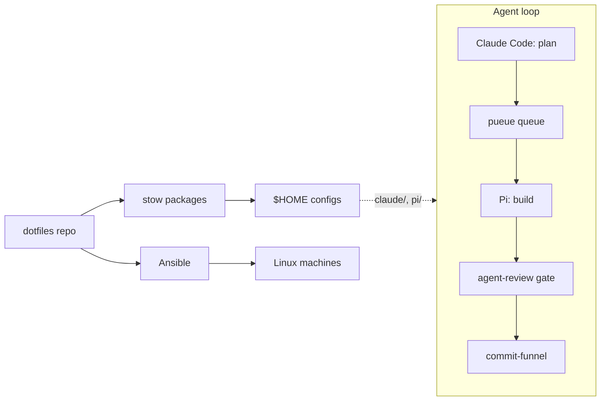

# dotfiles

Personal configuration for macOS and Linux, managed with [GNU Stow](https://www.gnu.org/software/stow/). Each top-level directory is a stow package that mirrors its layout under `$HOME`. Ansible provisions fresh Linux machines, mise pins the dev tools, and the repo also carries the agent workflow used for AI-assisted coding. Theme: Catppuccin Macchiato.



## Prerequisites

- git, with SSH access to GitHub (the `llm-wiki` submodule uses an SSH URL)
- macOS: [Homebrew](https://brew.sh)
- Linux: Ubuntu or Debian for the bootstrap script, or Ansible for other targets

## Installation

macOS:

```sh
git clone --recurse-submodules git@github.com:vietbui1999ru/dotfiles.git ~/dotfiles
cd ~/dotfiles && brew bundle      # Brewfile: stow, tmux, herdr, kitty, ...
./scripts/bootstrap-dirs.sh       # create directories, materialize default configs
./scripts/restow.sh               # symlink configs into $HOME
mise install                      # dev CLIs and runtimes
```

Linux (Ubuntu desktop, from the box itself):

```sh
curl -fsSL https://raw.githubusercontent.com/vietbui1999ru/dotfiles/main/scripts/bootstrap-ubuntu.sh | bash
```

### Spec loop

The spec loop is the seven numbered rules between the `<!-- spec-loop:start -->` and `<!-- spec-loop:end -->` markers in `shared/AGENTS.md`. The same block is mirrored in `shared/research-tool-routing.md`; the two copies must stay identical. The rules themselves are canonical in that block; this section describes the workflow they govern.

Prerequisites: `python3` and `git`; approval also needs a macOS GUI session. The scripts are not on PATH, so call them as `~/dotfiles/scripts/spec` and `~/dotfiles/scripts/floor-guard`. `ac-run` remains as a compatibility name for `spec`, and approval records stay in `~/.local/state/ac-run/`. Those paths point at the primary checkout, which may be on another branch; when developing the scripts in a feature worktree, call that worktree's `scripts/` copy instead. The session-band `/gates` pane always uses the canonical `~/dotfiles/scripts/` copies.

1. **Grill.** The `grill-me` skill interviews you and writes `SPEC.md` at the repo root. `shared/templates/spec.md` is the starting template: copy it to the repo root as `SPEC.md` and set `branch:` to the current branch. Lint must pass: the sections Objective, Acceptance Criteria, Boundaries (Always / Ask first / Never) and Open Questions are required. The draft is committed on its feature branch only; rule 3 forbids merging a spec-only PR into `main`, because a root `SPEC.md` merged that way is never removed by the rule 7 archive.
2. **Approve (human only).** Open the session-band `/gates` pane to find matching specs (`SPEC.md` and `specs/*.md`) and pending Pi reviews across the current repo's worktrees. Select a spec to read every AC and its full verify command, then press Approve. Alternatively, run `~/dotfiles/scripts/spec approve SPEC.md` yourself in its worktree. Both paths require a person to click Approve in a macOS dialog; Cancel is the default, and timeout or dialog failure refuses approval. There is no stdin or terminal fallback: piping `y` cannot approve. To read the same complete summary without running commands or changing anything, use `spec show SPEC.md`. Approval runs the non-manual commands once for a baseline only when three things hold: a merge-base against `origin/HEAD`, `main` or `master` exists, no non-spec changes have been committed since that merge-base, and the working tree is clean apart from `SPEC.md`. Otherwise the baseline is recorded as unknown, and `check` later reports a passing command as `PASS (no baseline)`. It stores a record under `~/.local/state/ac-run/`, named by a hash of normalized values: the spec path relative to the repo, the branch, the AC ids, and each AC's `verify:` and `baseline:` values with leading and trailing whitespace stripped. Changing one of those values voids the approval (`check` exits 3), but these are limits of the record: leading or trailing whitespace changes keep it, edits to the Objective, Boundaries or AC prose do not void it, and an identical relative spec on the same branch in another repo on the same machine can reuse it. It then writes `status: approved` into `SPEC.md`, but `check` never reads the status line, so the record alone authorizes execution. If `SPEC.md` is read-only, `approve` prints a warning and still exits 0 after writing the record. Agents never run `approve`. `spec reject SPEC.md` removes the record for the current verify lines and sets `status: draft`; it runs no command and exits 0 whether or not a record existed. `spec status SPEC.md` prints `approved (record matches)`, `draft (no record)` or `stale (spec changed since approval; approve again)`, and exits 0 only when approved.
3. **Implement.** An agent reads `SPEC.md` when its `branch:` matches the current branch, works only toward its AC ids, and obeys its Boundaries.
4. **Verify.** The `verify-spec` skill runs `~/dotfiles/scripts/spec check SPEC.md` and `~/dotfiles/scripts/floor-guard`. `check` exits 0 when every AC is PASS or MANUAL, 1 on FAIL, TIMEOUT or PRE-SATISFIED (an AC that was already true before the change), 2 on a lint or branch error, and 3 when no approval record exists. `floor-guard` is advisory: exit 0 clean, 1 findings, 2 error. It diffs against the merge-base with `origin/HEAD`, `main` or `master`; when none exists it exits 2 with `no base; pass --base <ref>`, so pass `--base <ref>` (a repo with no commits exits 2 even then). It flags added suppressions, skipped or deleted tests, removed assertions, and stubs or swallowed errors, and scans untracked files too. On exit 3 the agent stops and asks the human for approval; on FAIL, TIMEOUT or PRE-SATISFIED it fixes the code and reruns, and it reports `floor-guard` findings as they are, without rewording code to dodge them. Rule 6 says stop after 3 tries, while `verify-spec` allows 3 fix-and-rerun cycles after the first run; this README does not reconcile the two, and where they differ the rule governs. Rule 4 forbids editing a `verify:` line or a test to make a check pass, and `verify-spec` also forbids editing `baseline:` lines. `verify-spec` permits one narrower edit that rule 4 does not mention: replacing the placeholder body of a test stub the agent wrote for this spec with real assertions.
5. **Review and PR.** Review the diff through the gate described in `docs/workflows/agent-review.md` before it is pushed or merged. The gate is a human workflow; neither script enforces it. Then push the branch and open a draft PR. Before the PR is marked ready or merged, rule 7 archives the spec as the branch's last commit (`git mv SPEC.md docs/specs/<YYYY-MM-DD>-<slug>.md`, `verify-spec` Step 5), so `main` never keeps a root `SPEC.md` and the next spec cannot collide with it. Run `check` and `floor-guard` before the archive; both expect `SPEC.md` at the root. The approval record is keyed outside the repo and is not touched.

In `/gates`, `j`/`k` select a row, `a` approves, `x` rejects (press twice to confirm), `e` edits a spec in Neovim, `o` opens a Pi review, and `r` refreshes. Spec state comes from `spec status`: draft, approved, stale, or invalid (with the error and approval disabled). Review rows show landed, processing, error and orphan tags; rejecting an orphan skips its leftover refs. `b`/`f` cycle open mod panes, `w` opens Worktrees, and `q` closes Gates. Review approval still uses agent-review's own macOS dialog; detailed diff review stays in Neovim.

Tests for both scripts: `python3 scripts/tests/test_spec_loop.py`. Pane tests: `cd session-band-plugin && claude plugin test .`.

### Stacked pull requests

Use GitHub's `gh stack` extension for a single feature split into dependent,
reviewable layers. Plan layer boundaries before coding; review and approve each
layer through the existing review gate before committing it. Keep unrelated work
in separate stacks.

```sh
ansible-playbook ansible/site.yml --limit dev_debian -i ansible/inventory/hosts.yml
```

Agent invocations must use named `init`/`add` branches, `submit --auto`, and
`view --json`; see `docs/workflows/stacked-prs.md` for recovery and review
rules.

### jj (default VCS)

`jj` (Jujutsu) is the default VCS for both the human and agent sessions. Each
checkout or worktree is colocated with git (`jj git init --colocate`), so
agent-review, `spec`, `floor-guard` and session-band keep reading git state.
Agents commit only through `scripts/commit-funnel`, which in jj mode also tracks
the paths, moves the bookmark and runs `git switch <branch>`; inside agent
worktrees plain `git commit`/`jj commit` and other branch moves are blocked (see
the "Git history" section of `shared/research-tool-routing.md` and
`docs/workflows/worktree-guard-bandaid.md`). The workflows below are the human's. Claude's `settings.json` allows `jj` and denies
pushing or moving `main`/`master`.

Three workflows:

- **Review Pi's commits by rewriting**, after its pueue task finishes:
  `jj log -r 'main..feat/x'`, then `jj abandon` / `jj squash --from A --into B` /
  `jj split -r C`, then `jj git push -b feat/x`. Undo with `jj op undo`.
- **Sync a branch without merge commits:** `jj git fetch && jj rebase -b feat/x -d main@origin`.
- **Quick tweak:** `jj new main`, edit, `jj file track <path>`,
  `jj describe -m ...`, `jj bookmark create fix/x -r @`, `jj git push -b fix/x`,
  `gh pr create`.

After any jj operation git HEAD is detached, so run `git switch <branch>` before
running agents or `spec`. Never rewrite a branch that a running Pi worktree has
checked out.

### Pi-first workflow

Pi is the only supported agent harness. Commandr is the task service,
DiffView is the review service, and Obsidian is the human UI. Other vendors
are model providers or explicit CLI bridges, not parallel harnesses.

```sh
# Pi TUI
/sessions
/review
```

After editing or adding a package, re-run `./scripts/restow.sh`. It is idempotent and is the source of truth for the packages it manages: `zsh starship mise nvim tmux tmuxinator kitty git jj claude opencode pi codex herdr`. Packages not in that list (`aerospace`, `sketchybar`, `mouseless`, `launchd`, `i3`) are stowed by hand where used, and `i3` is applied by Ansible on Linux. Back up an existing live config before the first stow of a package.

Upgrade mise-managed tools with `mise up`, not `brew upgrade`. Machine-local shell overrides go in `~/.zshrc.local` (untracked). To refresh the wiki submodule pin: `git submodule update --remote repos/llm-wiki`.

## What's inside

- Shell and terminal: zsh, starship, kitty, tmux and tmuxinator, herdr
- Editor: Neovim
- Version control: git, jj (default VCS), `gh` with `gh-stack`
- Tooling: mise for CLIs and runtimes, Homebrew for the rest
- macOS desktop: aerospace, sketchybar, mouseless; Linux desktop: i3
- Agents: Claude Code (`claude/`), Codex (`codex/`), OpenCode (`opencode/`), Pi coding agent (`pi/`)
- Agent workflow in `scripts/`: `pueue-safe`, `pi-queue` and `pi-view` for dispatching Pi through pueue, `agent-review` as the review gate, `commit-funnel` for agent commits, and `ac-run` and `floor-guard` for the spec loop
- Shared agent rules, skills and MCP server list in `shared/`, synced out by `scripts/sync-agent-rules.sh`
- Docs: workflows in `docs/workflows/`, specs in `docs/specs/`
- Submodule: `repos/llm-wiki`, the shared knowledge base and Claude rules/skills
