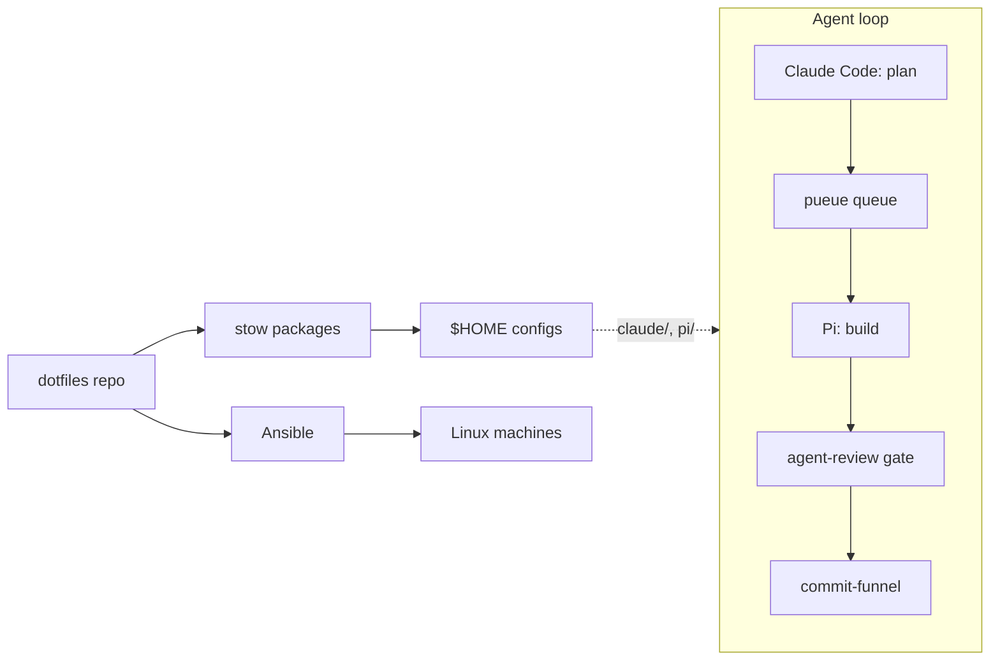

# dotfiles

Personal configuration for macOS and Linux, managed with [GNU Stow](https://www.gnu.org/software/stow/). Each top-level directory is a stow package that mirrors its layout under `$HOME`. Ansible provisions fresh Linux machines, mise pins the dev tools, and the repo also carries the agent workflow used for AI-assisted coding. Theme: Catppuccin Macchiato.



## Prerequisites

- git, with SSH access to GitHub (the `llm-wiki` submodule uses an SSH URL)
- macOS: [Homebrew](https://brew.sh)
- Linux: Ubuntu or Debian for the bootstrap script, or Ansible for other targets

## Installation

macOS:

```sh
git clone --recurse-submodules git@github.com:vietbui1999ru/dotfiles.git ~/dotfiles
cd ~/dotfiles && brew bundle      # Brewfile: stow, tmux, herdr, kitty, ...
./scripts/bootstrap-dirs.sh       # create directories, materialize default configs
./scripts/restow.sh               # symlink configs into $HOME
mise install                      # dev CLIs and runtimes
```

Linux (Ubuntu desktop, from the box itself):

```sh
curl -fsSL https://raw.githubusercontent.com/vietbui1999ru/dotfiles/main/scripts/bootstrap-ubuntu.sh | bash
```

The script installs git and Ansible, clones the repo over HTTPS, and runs the `ubuntu_desktop` play. Other targets use `ansible/site.yml`, which has plays for macOS (`localhost`), `dev_debian`, `ubuntu_desktop` and `admin_redhat`:

```sh
ansible-playbook ansible/site.yml --limit dev_debian -i ansible/inventory/hosts.yml
```

## Setup and restow

After editing or adding a package, re-run `./scripts/restow.sh`. It is idempotent and is the source of truth for the packages it manages: `zsh starship mise nvim tmux tmuxinator kitty git jj claude opencode pi codex`. Packages not in that list (`aerospace`, `sketchybar`, `mouseless`, `herdr`, `launchd`, `i3`) are stowed by hand where used (`stow herdr`), and `i3` is applied by Ansible on Linux. Back up an existing live config before the first stow of a package.

Upgrade mise-managed tools with `mise up`, not `brew upgrade`. Machine-local shell overrides go in `~/.zshrc.local` (untracked). To refresh the wiki submodule pin: `git submodule update --remote repos/llm-wiki`.

## What's inside

- Shell and terminal: zsh, starship, kitty, tmux and tmuxinator, herdr
- Editor: Neovim
- Version control: git, jj (default VCS), `gh` with `gh-stack`
- Tooling: mise for CLIs and runtimes, Homebrew for the rest
- macOS desktop: aerospace, sketchybar, mouseless; Linux desktop: i3
- Agents: Claude Code (`claude/`), Codex (`codex/`), OpenCode (`opencode/`), Pi coding agent (`pi/`)
- Agent workflow in `scripts/`: `pueue-safe`, `pi-queue` and `pi-view` for dispatching Pi through pueue, `agent-review` as the review gate, `commit-funnel` for agent commits, and `ac-run` and `floor-guard` for the spec loop
- Shared agent rules, skills and MCP server list in `shared/`, synced out by `scripts/sync-agent-rules.sh`
- Docs: workflows in `docs/workflows/`, specs in `docs/specs/`
- Submodule: `repos/llm-wiki`, the shared knowledge base and Claude rules/skills
